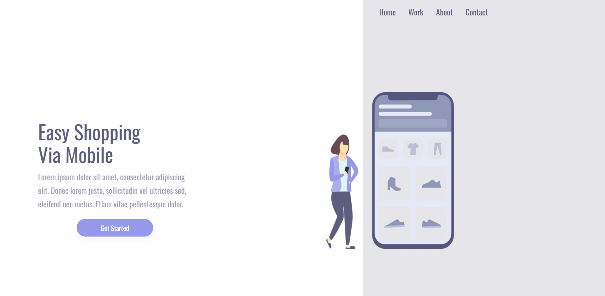

Segundo projeto para praticar responsividade para aparelhos mobile;  
Site web voltado para melhorar minhas habilidades em HTML, CSS e em responsividade para aparelhos móveis;

<h2>Tecnologias utilizadas</h2>
 

- HTML

- CSS

Resultado do projeto:

 

