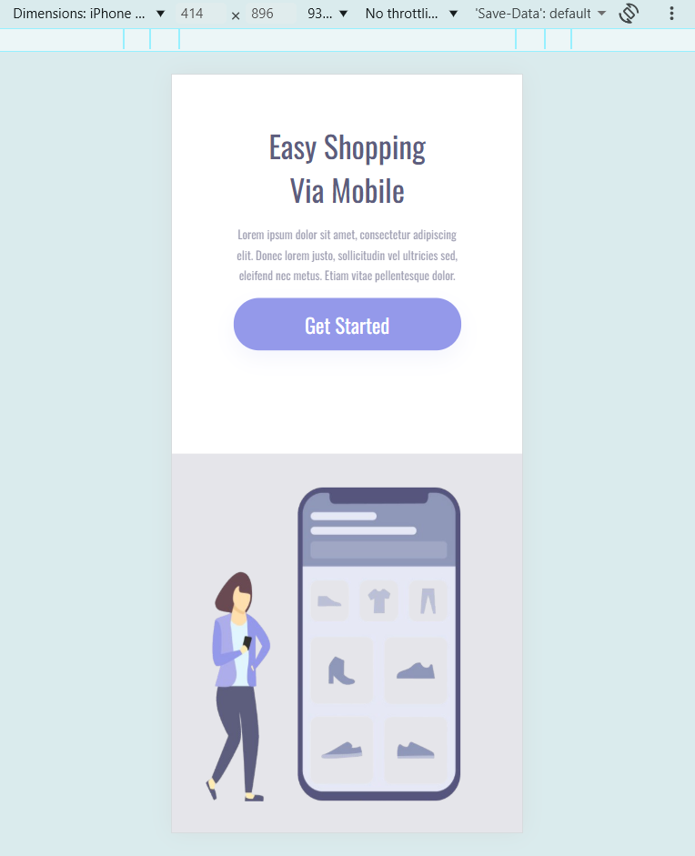

# 📱 Landing Page Responsiva - Mobile & Desktop

Segundo projeto prático com foco total em **design responsivo** e adaptação para dispositivos móveis (*Mobile First*), aprimorando conceitos fundamentais de estilização moderna com CSS3 e estruturação semântica com HTML5.

---

### 🌐 Demonstração Online

Teste a responsividade do site diretamente no seu navegador ou smartphone:

👉 **[Clique aqui para ver o site online](https://lmvc007.github.io/projeto-2/)**

---

### 📸 Preview do Projeto

Veja a adaptação do layout para diferentes tamanhos de tela:

#### 💻 Versão Desktop (PC)
<p align="center">
  
</p>

#### 📱 Versão Mobile (Smartphone)
<p align="center">
  
</p>

---

### ✨ Aprendizados e Destaques

- 📐 **Media Queries:** Aplicação de pontos de quebra (*breakpoints*) para reestruturar elementos conforme a largura da tela.

- 📱 **Mobile First:** Foco na experiência do usuário em aparelhos móveis sem quebrar a versão para telas maiores.

- 🎨 **Layout Moderno:** Uso de Flexbox/Grid para alinhamento fluído e sem quebras de layout indesejadas.

---

### 🛠️ Tecnologias Utilizadas

- **HTML5:** Estrutura semântica e acessível da página.

- **CSS3:** Estilização visual, regras de responsividade e alinhamentos.

---

### 💻 Como rodar o projeto localmente

Caso queira clonar e analisar a estrutura de código:

1. Clone o repositório:
```bash
git clone https://github.com/LMVC007/projeto-2.git


